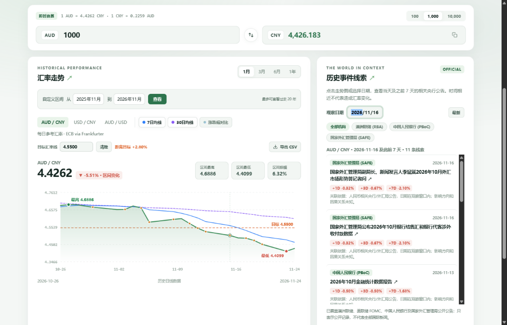
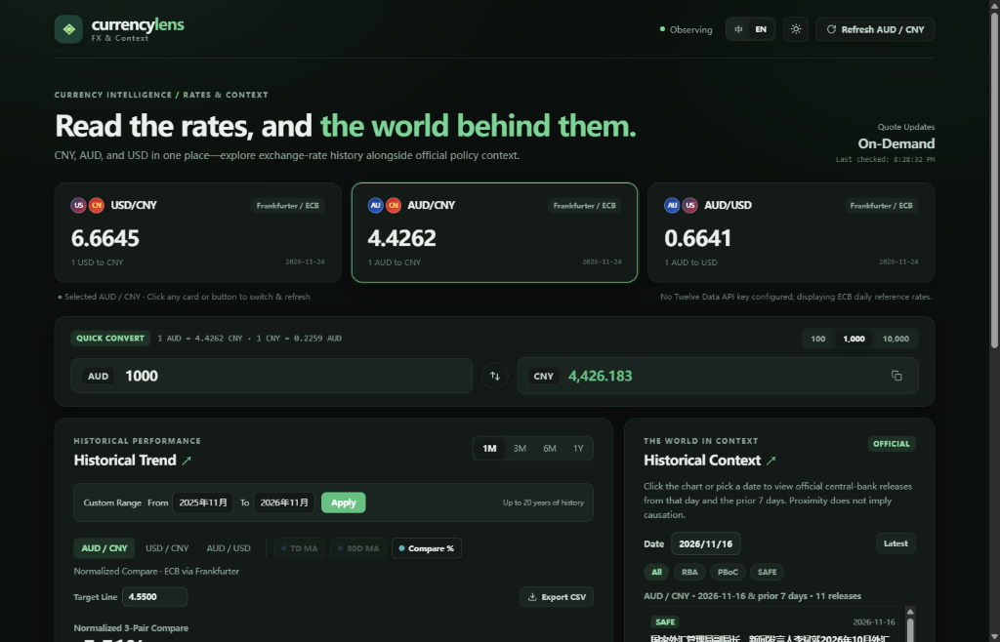

# CurrencyLens

**A currency research dashboard connecting exchange-rate history with central-bank events.**

[简体中文](README.zh-CN.md) · English

CurrencyLens is a Java and Spring Boot learning project for exploring **USD/CNY**, **AUD/CNY**, and **AUD/USD**. It combines labeled exchange-rate sources, interactive SVG charts, moving averages and multi-pair normalized comparison, a quick converter, links to official central-bank announcements (RBA, Federal Reserve, PBoC, and SAFE), post-release rate movement context, and an experimental event-conditioned baseline.

> **Research prototype:** Historical rates and announcements can be delayed or incomplete. Related events and post-release moves are descriptive context for further reading, not proof of causation. The experiment does not interpret news content or establish forecasting ability. Do not use it as investment advice.

## Preview

| Light Mode (简体中文) | Dark Mode (English) |
| --- | --- |
|  |  |

## Features

- **Three currency pairs & quick converter:** Live/reference quotes for USD/CNY, AUD/CNY, and AUD/USD with clickable ticker cards, unit/inverse rate display, preset amounts, currency swap, and clipboard copy.
- **Interactive SVG chart:** Responsive geometry with hover crosshair, date selection, period High/Low/Spread metrics, and up to 20 years of monthly custom history.
- **Analytical overlays & tools:** Toggle **7-Day & 30-Day Moving Averages (`MA7` / `MA30`)**, **Normalized `%` Compare** across all three pairs, a custom **Target Rate** reference line per pair, and **CSV export** for the active range.
- **Official central-bank context:** Browse **Reserve Bank of Australia (RBA)** media releases, **US Federal Reserve FOMC** statements, **People's Bank of China (PBoC)** releases, and **State Administration of Foreign Exchange (SAFE)** news near any selected date, with agency filters and descriptive `+1D / +3D / +7D` post-release moves.
- **Bilingual & adaptive UI:** Instant **Chinese / English** switching, **Light / Dark** theme toggle with system preference detection, and Apple-native typography (`SF Pro` / `PingFang SC` with tabular numerals).
- **On-demand updates:** Loads quotes when opened; manual refresh updates only the selected pair with no background polling.
- **Experimental comparison:** Rolling historical evaluation comparing a simple 7-day prior-event indicator against a previous-direction trend baseline.

## Getting started

Requirements: Java 21, an internet connection, and Windows, macOS, or Linux. The included Maven wrapper downloads Maven on first use.

```powershell
# Windows PowerShell, from the project directory
.\mvnw.cmd spring-boot:run
```

```bash
# macOS / Linux
./mvnw spring-boot:run
```

Open [http://localhost:8080](http://localhost:8080). Alternatively, run `CurrencylensApplication` from your Java IDE.

### Optional: Twelve Data quotes

Without an API key, CurrencyLens displays daily ECB reference rates via [Frankfurter](https://frankfurter.dev/). To use [Twelve Data](https://twelvedata.com/) quotes and historical daily prices, obtain a personal API key and set it **in the environment of the process that starts the app**:

```powershell
# Windows PowerShell — replace the placeholder locally
$env:TWELVE_DATA_API_KEY = 'YOUR_API_KEY'
.\mvnw.cmd spring-boot:run
```

```bash
# macOS / Linux
export TWELVE_DATA_API_KEY='YOUR_API_KEY'
./mvnw spring-boot:run
```

Never commit a real key. Availability, market coverage, delay, credit limits, and display rights depend on the provider and your plan. Check the provider's terms before deploying or redistributing data.

The application requests up to three quotes and the selected pair's historical series at page load. Changing the pair or range may trigger additional historical-data requests; long ranges are split into multiple requests. Quotes are cached for 30 seconds, series and custom history ranges for 15 minutes, and historical events for 4 hours (2 minutes if empty) per app instance. Manual refresh requests only the selected quote. No background polling is performed.

## Data and limitations

| Item | Source and interpretation |
| --- | --- |
| Default rates | ECB daily reference rates via Frankfurter, converted to cross rates. They are not live trading prices. |
| Optional quotes and chart | Twelve Data, subject to your account's access. The chart uses daily closes and, when the displayed range includes the current date, the latest available quote. If history is unavailable, the chart explicitly falls back to ECB data. |
| Historical events | Official archives from RBA media releases, Federal Reserve FOMC statements, PBoC press releases / monetary policy chronicles, and SAFE FX news. Coverage focuses on the last three calendar years; broader international news is not yet included. |
| Experiment | Uses only whether a relevant official release appeared in the previous seven days. It excludes same-day events, compares against a simple trend baseline, and may be affected by small samples or subsequent changes to source archives. It does not analyze article content or trading costs. |

Chart highs and lows reflect the displayed daily values and any current quote shown, not intraday extremes. Provider archives can change or become temporarily unavailable.

## Tests

```powershell
.\mvnw.cmd test
```

The tests include Spring application startup, mocked Twelve Data history handling, MarketController validation, and offline HTML parser tests for RBA, Federal Reserve, PBoC, and SAFE archives.

## Technology

Java 21 · Spring Boot · Maven · Vanilla JavaScript · Responsive SVG · jsoup · GitHub Actions CI

## Project status

This is an evolving personal learning and research project. Potential future directions include persisting historical announcements locally, adding central-bank policy rate differentials, and expanding currency pair coverage.
