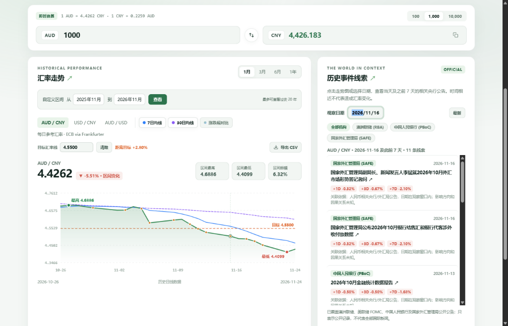
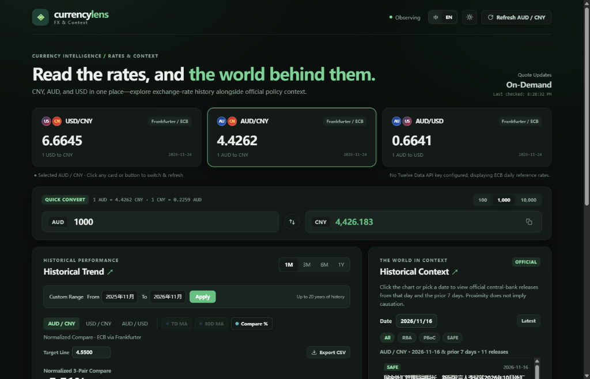

# CurrencyLens

**将汇率走势与央行事件放在一起查看的货币研究看板。**

简体中文 · [English](README.md)

CurrencyLens 是一个基于 Java 和 Spring Boot 的货币研究项目，关注 **USD/CNY**、**AUD/CNY** 与 **AUD/USD**。它结合标明来源的汇率报价、响应式 SVG 走势图、移动均线与多货币对归一化对比、即时换算器、官方央行与外汇局历史公告（澳洲联储 RBA、美联储 FOMC、中国人民银行 PBoC、国家外汇管理局 SAFE）、公告后汇率变化参考，以及基于历史事件的滚动对比实验。

> **研究原型：** 历史数据和公告可能存在延迟或缺漏。相关事件与公告后参考变化仅作延伸阅读线索，不代表已证明因果关系。当前实验不理解新闻内容，也没有证明预测能力，请勿作为投资建议。

## 界面预览

| 白天模式（简体中文） | 夜间模式（English） |
| --- | --- |
|  |  |

## 功能

- **三组货币对与即时换算：** 展示 USD/CNY、AUD/CNY、AUD/USD；报价卡片可直接点击切换货币对，并附带即时换算条（快捷金额、双向交换、正反单位汇率及一键复制）。
- **响应式 SVG 走势图：** 悬停十字准线提示、点击曲线锁定观察日期、区间最高/最低/振幅统计，并支持按月份选择最长 20 年历史区间。
- **分析叠加与导出工具：** 支持 **7 日 / 30 日移动均线（`MA7` / `MA30`）** 开关、三组货币对 **归一化涨跌幅对比（`%`）**、按货币对保存的 **目标汇率参考线**，以及当前区间 **CSV 导出**。
- **官方央行与外汇事件线索：** 并行抓取近三个自然年的 **澳洲联储（RBA）**、**美联储（FOMC）**、**中国人民银行（PBoC）** 与 **国家外汇管理局（SAFE）** 公开公告，支持按机构筛选，并在每条公告下展示发布后 `+1D / +3D / +7D` 参考变化。
- **中英双语与自适应界面：** 顶栏支持 **中 / EN** 即时切换与 **白天 / 夜间模式** 平滑过渡（自动识别系统主题并持久化），采用苹果系统字体栈（`SF Pro` / `PingFang SC`）及等宽数字对齐。
- **按需刷新：** 进入页面时加载报价；点击刷新仅更新当前选中的货币对，不会在后台定时轮询。
- **实验性比较：** 按时间滚动回测一个基于此前 7 天是否出现相关央行公告的简单模型，并与沿用上一次涨跌方向的基线比较。

## 运行项目

需要 Java 21、网络连接，以及 Windows、macOS 或 Linux。项目自带 Maven Wrapper，首次运行时会自动下载 Maven。

在项目目录打开 PowerShell：

```powershell
.\mvnw.cmd spring-boot:run
```

macOS / Linux：

```bash
./mvnw spring-boot:run
```

浏览器打开 [http://localhost:8080](http://localhost:8080)。也可以在 Java 开发工具中直接运行 `CurrencylensApplication`。

### 可选：使用 Twelve Data 报价

不设置 Key 时，项目通过 [Frankfurter](https://frankfurter.dev/) 展示 ECB 每日参考汇率。若要使用 [Twelve Data](https://twelvedata.com/) 的报价和历史日线，请申请个人 Key，并在**启动程序的环境中**设置：

```powershell
# Windows PowerShell；请在本地替换占位文字
$env:TWELVE_DATA_API_KEY = 'YOUR_API_KEY'
.\mvnw.cmd spring-boot:run
```

```bash
# macOS / Linux
export TWELVE_DATA_API_KEY='YOUR_API_KEY'
./mvnw spring-boot:run
```

不要将真实 Key 提交到仓库。接口权限、市场覆盖、延迟、额度和展示授权取决于数据商与套餐；部署或再分发数据前，请查看数据商条款。

进入页面时，程序最多请求三组报价以及当前货币对的历史日线；切换货币对或历史区间可能产生额外日线请求，较长区间会分段请求。同一程序实例内，报价缓存 30 秒，日线及自定义区间缓存 15 分钟，历史公告缓存 4 小时（若抓取为空则 2 分钟后允许重试）。点击刷新只查询选中的报价，不会后台定时刷新。

## 数据来源与限制

| 内容 | 来源和含义 |
| --- | --- |
| 默认汇率 | Frankfurter 提供的 ECB 每日参考汇率，换算成交叉汇率；不是实时交易报价。 |
| 可选报价与走势图 | Twelve Data，权限取决于账户。走势图使用每日收盘价；包含当前日期时会加入最新可用报价。历史数据获取失败时，图表明确提示退回 ECB。 |
| 历史事件 | 最近三个自然年的澳洲联储媒体公告、美联储 FOMC 公告、中国人民银行新闻与货币政策大事记、国家外汇管理局外汇新闻；暂未覆盖更广泛的国际商业新闻。 |
| 事件实验 | 仅判断前 7 天是否出现相关官方公告，排除当日公告，并与简单趋势基线比较；样本可能较少，原始档案也可能发生补录或变更。实验不分析新闻内容或交易成本。 |

图上最高、最低值基于展示的日线和可能包含的当前报价，并非盘中极值。数据商的历史资料也可能变更或暂时不可用。

## 运行测试

```powershell
.\mvnw.cmd test
```

测试包括 Spring 程序启动、Twelve Data 历史响应模拟测试、参数校验测试，以及 RBA、美联储、中国人民银行与国家外汇管理局的离线 HTML 解析单测。

## 技术栈

Java 21 · Spring Boot · Maven · 原生 JavaScript · 响应式 SVG · jsoup · GitHub Actions CI

## 项目状态

这是一个持续演进的个人学习与研究项目。后续可进一步探索历史公告本地数据库持久化、中/美/澳基准利差对比以及更多主流货币对支持。
